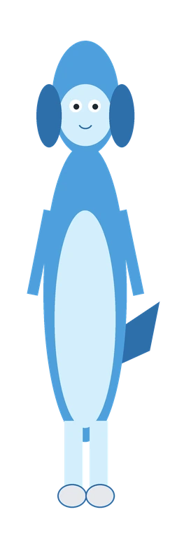

# 雏儿娘 · chuer-niang

一个可发布的 DSH Web 桌宠插件：照片形象、好感度、钱包、段位、白袜、LLM 自言自语和用户画像记忆。



> 仓库/发布包包含已授权公开的默认形象 `plugin/assets/pet.webp` / `pet-socks.webp`；本机 `%DSH_HOME%\photo-pet\` 里如果有私人形象，会优先显示本机版本。`master.json`、`affinity.json`、`scan-index.json` 等运行时数据仍然不随包发布。

## 现在有什么

- **位置**：右下角，380px 高；可拖动，位置记在 localStorage。
- **互动**：点一下会跳一下并说话；双击回到右下角。
- **Agent 联动**：`useSessionStatus` 读取真实会话状态——
  - 有会话在跑 → 敲字动画 +「在想… / 马上就好」；
  - 有审批/问题在等你 → 问号 +「这里要你点一下」；
  - 一轮结束 → 撒花 +「搞定！」，3 秒后回到待机。
- **待机**：呼吸、轻微浮动；会按人设让 DSH 默认模型生成一句自言自语（见下）。

## 交互说明

| 操作 | 效果 |
|---|---|
| 拖动 | 移动位置，松手后记住 |
| 单击头部 | 摸头：20% “摸你大爷摸，回去摸你娘去” -2；50% “好巴适，好爽嘛” +2；30% “妈呀，到顶了，老鼻子舒服了” +10 |
| 单击脚部 | 摸脚：10% “哪儿来的野猫，给爷爬，别摸玉足” -3；50% “想闻吗” +4；40% “舒服 巴适得板 恋足耍起嘛” +10 |
| 单击身体 | 戳一下：抖一下 + “!”，好感度 -1 |
| 右键 | 打开/关闭钱包 HUD |
| 双击 | 归位到右下角 |
| Enter / Space | 键盘戳一下 |
| Esc | 关闭钱包 |

## 钱包 HUD 与好感度

右键桌宠打开：

- **段位**：黑铁 → 赋能，按累计 token 算，旁边有霓虹段位牌和眼睛光效；
- **余额 / 家底**：DeepSeek 账户余额 + 档位（紧巴巴 / 还中 / 宽裕）；
- **本会话 / 今日饭量**：token 消耗（Host 从 `tokenMeter` 和 `assistant/message` usage 统计）；
- **投喂**：今日通过 token 喂出的好感次数；
- **峰谷**：按北京时间工作日 9–12、14–18 判断高峰/低谷；
- **好感度**：0–100，进度条 + 等级（嫌弃 / 嘴硬 / 亲近 / 黏人）。

好感度存在 **`%DSH_HOME%\photo-pet\affinity.json`**（私有运行时数据，不随发布包上传），摸头/摸脚按概率加减。好感低于 20 时，钱包面板会把账本数字藏起来（显示“——”）；**好感 100 时自动换白袜图**。

### 联动规则

- **Token = 饭量**：今日每 1M token 给好感 +1，每天最多 +5；高峰时段按半份饭折算（双倍饭钱），只会喂得更慢；吃满 5 顿会触发一句特殊台词；
- **余额 = 家底**：余额跌破 5 元触发“家底见底”台词；余额一次回升 ≥5 元触发好感 +3 和“算你有良心”；
- **峰谷**：高峰/低谷切换时各触发一次提醒；高峰继续烧 token 会触发“高峰烧钱”台词；
- **事件台词**：今日 token 破 10M、好感满 100、家底见底、充值、峰谷切换都会进事件队列，由钱包刷新时弹一句；
- **自言自语提示词**里会带好感、家底档位、今日饭量档位、峰谷，她会挑着说，不报精确数字。

## 段位系统

段位按**累计 token 消耗**（lifetimeTokens）计算，越往后越难升：

| 段位 | 累计 token |
|---|---|
| 黑铁雏儿 | 0 |
| 白银雏儿 | 50 万 |
| 黄金雏儿 | 200 万 |
| 铂金雏儿 | 1000 万 |
| 钻石雏儿 | 5000 万 |
| 神话雏儿 | 2 亿 |
| 赋能雏儿 | 10 亿 |

- 桌宠左侧有霓虹段位牌：段位名 + 当前 XP / 下一段 XP + 进度条 + 流光扫描；
- 段位越高眼睛越亮（眼睛位置叠加发光层），**赋能雏儿**会带两道镭射光束；
- 段位会写进 LLM 提示词：段位越高，脑子越灵光、越会看穿主人的心思，但土味和傲娇不丢；
- 升段会触发一次事件台词；
- 桌面 WPF 版目前同步白袜，段位牌和眼睛光效在网页版。

## LLM 自言自语（人设可改）

Host 半区注册了 `POST /photo-pet/generate`：优先读取 `%DSH_HOME%\photo-pet\persona.txt`（可选覆盖），否则解密仓库里的 `plugin/persona.enc`；再调用 DSH 的 `ctx.llm.stream`（默认模型，low reasoning），生成一句 30 字以内的中文口语返回给桌宠。

- **改人设（加密版）**：`node tools/unseal-persona.mjs > persona.txt`，编辑后 `node tools/seal-persona.mjs persona.txt`；
- **改人设（明文覆盖）**：直接把明文放到 `%DSH_HOME%\photo-pet\persona.txt`，下一次请求生效，不用重启；
- **加密方式**：AES-256-GCM + base64url 双层包装，密钥拆在 `plugin/persona-crypto.mjs` 里；仓库里只有密文，GitHub 搜索/浏览看不到明文；
- **边界**：这只是防君子不防小人——密钥在代码里，模型也必须收到明文；拿到仓库的人花点时间就能解，拿到运行机器的人更直接。真正的秘密不要靠这段加密；
- **操作感知**：Host 监听 `tools/result`，只记工具类别（跑命令 / 改文件 / 翻文件 / 上网 / 叫帮手 / 列单子 / 鼓捣插件配置…），不含参数和路径；最近 5 分钟的操作会写进提示词，所以她能真的挑你刚才那步的刺；
- **防复读**：客户端把最近 6 句一起发过去，Host 在提示词里要求避开，完全重复时自动重生成一次；
- **触发**：加载后约 3 秒来一句；之后每 10 秒一次（页面可见时，干活也会插话），气泡显示 10 秒；
- **兜底**：接口失败/超时/没配模型时，退回 `client.template.js` 里的本地台词（同样显示 10 秒）；
- **消耗**：每次一句，maxTokens 1024（reasoning + 文本）；每次约 1.5 秒。10 秒一次会比较费 token，建议只在想逗她的时候开。

仓库里的示例人设见 `plugin/persona.example.txt`；`plugin/persona.enc` 才是你的私密版本。

示例（用默认人设生成）：

> 主人这么晚还敲代码，眼睛要瞎啦喵

> 都十点了喵，主人你水杯里的水都凉了吧。

## 桌面悬浮版（Windows）

双击 [`desktop/start-pet.vbs`](<desktop/start-pet.vbs>)：一个透明、无边框、**始终置顶**的 WPF 小窗口，飘在桌面和其他应用上方，不占任务栏、不进 Alt+Tab。

- 拖动移动；点头部摸头、点脚部摸脚、点身体戳一下；右键「钱包 / 归位 / 退出」；
- **复用 DSH 能力**：桌面版通过本地接口调用 `/photo-pet/generate`（LLM 自言自语、人设、操作感知）、`/photo-pet/interact`（摸头/摸脚概率与好感度）、`/photo-pet/wallet`（余额/token/峰谷/投喂）；
- DSH 开着时，桌宠和网页版共用同一份 `%DSH_HOME%\photo-pet\affinity.json` 好感度；好感 100 时桌面版也会换成白袜图；DSH 没开时退回本地台词和 `%APPDATA%\photo-pet\desktop.json` 里的本地好感度；
- 位置存在 `%APPDATA%\photo-pet\desktop.json`；
- 窗口矩形范围会挡住下面应用的点击，目前没有做逐像素点击穿透；
- 仅 Windows；调试用 `desktop/start-pet-debug.cmd`。

## 用户画像扫描器（后台进程）

插件 Host 启动时会拉起 `plugin/scanner.mjs`，之后每 60 秒检查一次：进程没了就重启；`scanner.lock` 防止重复实例。

- **数据文件**（都在 `%DSH_HOME%\photo-pet\`）：
  - `master.json`：`profile.summary` + 每个文件的 summary；
  - `scan-index.json`：已扫文件表（mtime/size），扫过的直接跳过；
  - `scan-config.json`：扫描根目录、扩展名、限流参数，可直接改；
- **默认扫 workspace + Documents + Desktop + Downloads**（有权限就扫，读不到的目录直接跳过）；跳过 `node_modules/.git/AppData/.dsh`、二进制、超大文件和敏感文件名；
- **限流**：约 0.3 秒一个文件（LLM 摘要本身约 1~2 秒）、每 10 个文件歇 3 秒、每轮最多 500 个、一轮扫完歇 2 分钟；单次遍历最多 5000 个文件/30 秒预算；
- **Summary 用 LLM**：每个文件调 Host 的 `/photo-pet/summarize`（默认模型，low reasoning），生成 80 字以内摘要；每天最多 300 次，超限/失败自动退回本地首段摘要；
- `master.json` 的 profile summary 会塞进自言自语提示词（“你对主人的了解……”），让她慢慢知道你在做什么；
- **隐私**：master 里会有文档片段，只存在本机 DSH_HOME；但 summary 会发给模型。不想要就删 `master.json` / 改 `scan-config.json` 的 roots；LLM 摘要会消耗 token。

## 安装状态

已经通过 DSH 的 `plugin_manager` 装进当前 **desktop** profile，包名 `chuer-niang`，并在 `shell.overlay` 注册（active）。

如果界面上没看到：

1. 先刷新当前 DSH 窗口（`Ctrl+R` / `Cmd+R`）；
2. 还不行就重启一次 DSH（客户端 bundle 只在启动时加载）；
3. 仍然没有，检查 设置 → 插件 里「照片桌宠」是否启用。

## 卸载 / 停用

- 设置 → 插件 → 找到「照片桌宠」→ 停用；
- 或命令行：

```bash
dsh plugin --profile desktop remove chuer-niang
```

## 它是怎么做的

1. **抠图**：本地跑 RMBG-1.4（Bria）ONNX，得到人物 alpha；再用 GrabCut 的 trimap 思路 + 手工多边形/颜色阈值清掉照片里的塑料袋、粉色衣架条等残留。
2. **贴纸化**：alpha 膨胀 7px 生成白色描边，裁到内容边界，缩到 760px 高（显示时 380px，2x 屏也清楚），压成 WebP（约 39KB）。
3. **插件**：`shell.overlay` 槽位里渲染一个 fixed 容器；React + CSS 动画；`useSessionStatus` 驱动三种状态；SVG/emoji 徽标与气泡用 DSH 主题 token 取色。
4. **打包**：客户端图片通过 Host 的 `/photo-pet/image` 读取；包内带已授权公开的默认形象，本机 `%DSH_HOME%\photo-pet` 里的私人照片优先。`master.json` 等运行时数据不进仓库/发布包。

## 文件

```
pet/
  plugin/                 # 可安装插件
    package.json
    cordis.patch.yml
    index.js              # Host 半区：LLM 自言自语接口
    scanner.mjs           # 后台文档扫描进程
    persona.example.txt   # 公开示例人设
    persona.enc           # 私密人设密文（可提交）
    persona-crypto.mjs    # 加密/解密（密钥也在这里，防君子）
    client.js             # 浏览器半区：桌宠本体（图片走 /photo-pet/image）
    icon.png
    locale/{zh,en}.json
    assets/pet.webp       # 已授权公开的默认形象
    assets/pet-socks.webp
  tools/
    seal-persona.mjs      # 明文 -> plugin/persona.enc
    unseal-persona.mjs    # plugin/persona.enc -> 明文
  desktop/                # Windows WPF 桌面悬浮版（可选）
    PetOverlay.ps1
    start-pet.vbs
    start-pet-debug.cmd
  client.template.js      # client.js 源模板
```

## 换成自己的照片

把抠好的透明 WebP 放到 `%DSH_HOME%\photo-pet\pet.webp`（白袜版放 `pet-socks.webp`）即可，Host 的 `/photo-pet/image` 会自动优先读取；没有就使用 `plugin/assets` 里的已授权默认形象。原始私人照片不需要、也不会自动进仓库；发布版用的是 `plugin/assets` 里的公开副本。

## 说明

- 没有使用 Live2D，也没有使用任何第三方角色素材；默认公开形象已授权随包发布，原始私人素材仍在 `%DSH_HOME%`。
- 抠图模型 RMBG-1.4 只在本机跑，模型权重不随插件分发；其许可为非商业使用，个人桌宠没问题。
- 视觉验证受限于当前没有浏览器控制能力：已做语法检查、清单校验和 `shell.overlay` 活体槽位确认；实际渲染请以界面为准。
